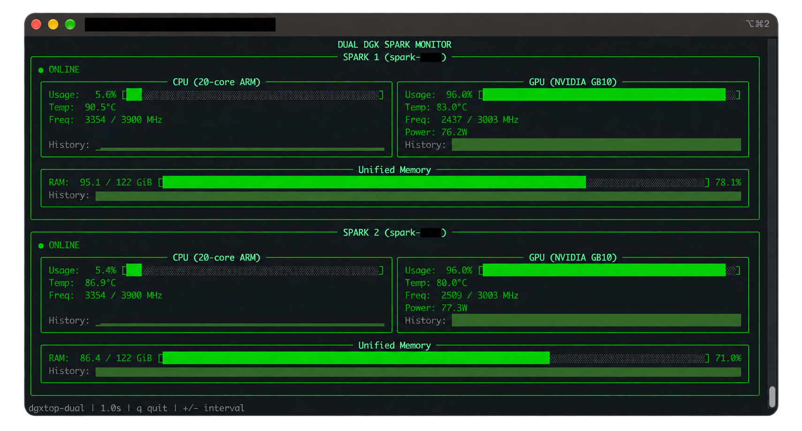

# DGXTOP for Dual DGX Sparks

Monitor two connected NVIDIA DGX Sparks from one terminal.
Code adapted from [dgxtop](https://github.com/GigCoder-ai/dgxtop).



This code assumes 2x DGX Spark connected with QSFP, and configured following [Nvidia's official guide](https://build.nvidia.com/spark/connect-two-sparks/stacked-sparks).

| Spark | Address | Collection |
| --- | --- | --- |
| spark 1 (main) | 192.168.100.10 | Local |
| spark 2 | 192.168.100.11 | SSH |

Run this application on **spark 1**.

## Installation

In your main spark, run

```bash
git clone https://github.com/johnsk95/dgxtop-dual.git
cd ~/dgxtop-dual
./install.sh
```

SSH to the second Spark must work without a password prompt. The app uses your
SSH configuration, or your current login username by default. If the second Spark
has a different login username, use `--ssh-user` or set `User` for
`192.168.100.11` in `~/.ssh/config`. No usernames are needed during installation.

## Run

### Basic Usage

```bash
dgxtop-dual
```

### Options

```bash
dgxtop-dual --full  # Full interface
dgxtop-dual --interval 0.5  # Update every 0.5 seconds
dgxtop-dual --interval 2    # Update every 2.0 seconds
dgxtop-dual --ssh-user alice  # Different login username on spark 2
```

### Controls

| Key | Action |
| --- | --- |
| `q` or Ctrl+C | Quit |
| `+` / `-` | Update faster / slower |


## Source

Derived from [dgxtop](https://github.com/GigCoder-ai/dgxtop) by [GigCoder.ai](https://github.com/GigCoder-ai).
